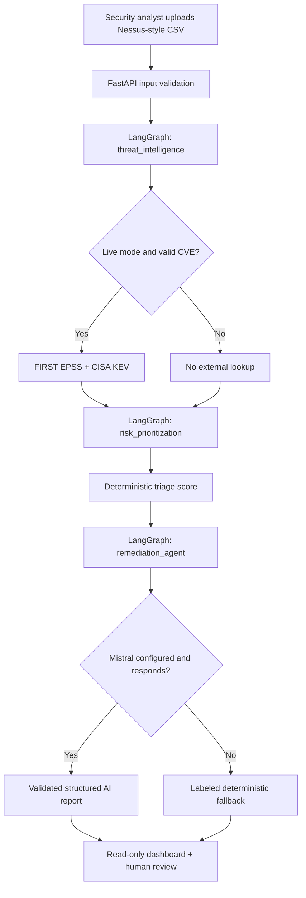
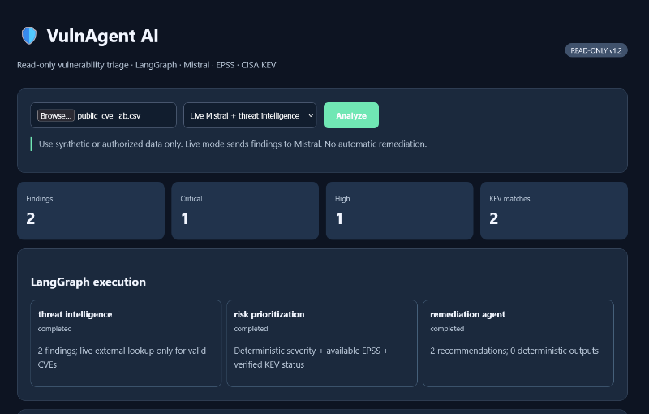
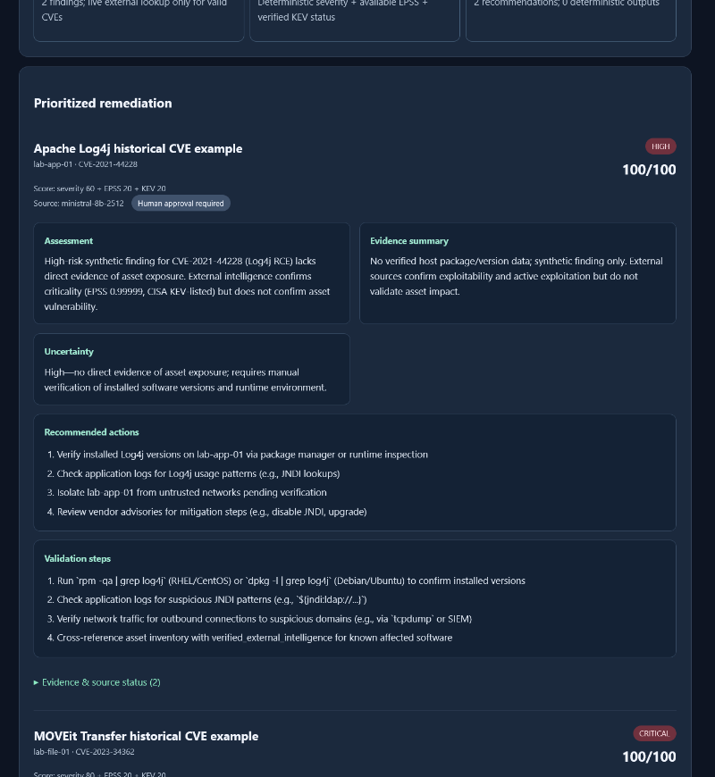

# VulnAgent AI

**Read-only, AI-assisted vulnerability triage using Python, LangGraph, Mistral, EPSS and CISA KEV.**

VulnAgent AI turns Nessus-style CSV findings into a prioritized review queue. It enriches valid CVE identifiers with public threat intelligence, calculates a transparent triage score, and asks Mistral for structured, human-reviewable remediation guidance. A browser dashboard shows evidence, workflow status and recommendations.

> **Status:** Local MVP, v1.2.0. Not production-ready. No scanning, exploitation, patching or remote execution. Do not upload confidential or customer data without permission.

## What it does

- Imports Nessus-style CSV files (`Host`, `Name`, `Risk`; optional `CVE`, `Description`, `Solution`), with input validation and size limits.
- In **live mode**, looks up FIRST EPSS and CISA Known Exploited Vulnerabilities (KEV) information for valid CVEs.
- Applies a **deterministic**, inspectable risk-scoring heuristic and ranks findings.
- Uses a three-node **LangGraph StateGraph** to orchestrate enrichment, prioritization and remediation generation.
- Requests **structured JSON** remediation guidance from Mistral, separating assessment, evidence summary, uncertainty, recommended actions and validation steps.
- Shows when external intelligence or Mistral is unavailable and uses a labeled deterministic fallback.
- Requires human review before any remediation; the application never executes fixes.

## Architecture



The nodes are **fixed processing stages**, not independently planning autonomous agents. This version does **not** implement vector search, embedding-based RAG, or automatic remediation. See [architecture and design decisions](docs/ARCHITECTURE.md).

## Example output

Each finding includes a priority score and breakdown, CVE evidence when available, a model/fallback label, and these structured report sections:

| Section | Purpose |
|---|---|
| Assessment | What the scan claims and why it may matter |
| Evidence summary | Retrieved intelligence and its limits |
| Uncertainty | What is not verified about the affected asset |
| Recommended actions | Steps for a human analyst to review |
| Validation steps | How to verify the finding and approved remediation |

### Dashboard preview



### Structured remediation report



*Screenshots are from a local v1.2 run with `samples/public_cve_lab.csv`, using publicly documented CVEs on **simulated assets**. These are not evidence of vulnerabilities on real hosts. Model output and threat intelligence may vary between runs.*

See the [screenshot guide](docs/SCREENSHOTS.md) for how to replace these captures safely.

## Quickstart (Windows PowerShell)

Prerequisites: Python 3.11+ and an optional Mistral API key for live model responses.

```powershell
py -m venv .venv
.\.venv\Scripts\Activate.ps1
python -m pip install -r requirements.txt
Copy-Item .env.example .env
```

Edit `.env` to set `MISTRAL_API_KEY` and `MISTRAL_MODEL`. Never commit `.env`. Load it into the current PowerShell session:

```powershell
Get-Content .env | ForEach-Object { if ($_ -match '^\s*(MISTRAL_API_KEY|MISTRAL_MODEL)\s*=\s*(.+?)\s*$') { [Environment]::SetEnvironmentVariable($matches[1], $matches[2].Trim().Trim('"').Trim("'"), 'Process') } }
python -m pytest -q
uvicorn app.main:app --reload
```

Visit **http://127.0.0.1:8000**. The API documentation is at **http://127.0.0.1:8000/docs**.

Upload `samples/nessus_demo.csv` for a synthetic demo, or `samples/public_cve_lab.csv` for **public CVE identifiers on simulated assets**. Select **Demo** for offline deterministic results, or **Live** for external lookups and Mistral (subject to API access and quotas).

### Run with curl (optional)

```bash
curl -F "file=@samples/nessus_demo.csv" "http://127.0.0.1:8000/analyze?mode=demo"
```

## How priority scores work

```text
score = min(100, severity_level * 20 + round(20 * EPSS) + (20 if KEV listed else 0))
```

Severity levels map to 0–4. Missing EPSS/KEV information contributes no additional points but **does not imply safety**. The score is an illustrative triage heuristic, **not CVSS, calibrated exploit likelihood, or confirmed asset exposure**. Multiple high-risk findings may saturate at 100. Improving discrimination is a planned enhancement.

## Evaluation and reliability

Run `python -m pytest -q`. Existing tests cover parsing, application behavior and structured report handling. This MVP does **not** yet include a benchmarked agent-evaluation dataset, autonomous tool-selection metrics or a demonstrated reduction in analyst time. Those are roadmap items.

Live requests can be rate-limited or time out. The dashboard labels fallback results; a successful local HTTP response alone does not prove the model was called successfully.

## Security and limitations

- **Local use only:** no authentication, persistent storage or tenant isolation. Do not expose the app publicly.
- **Read-only:** no network scanning, exploitation, remote commands or automated patching.
- **Data disclosure:** live mode sends finding details to the configured Mistral API, sends CVE identifiers to FIRST EPSS and retrieves the CISA KEV catalog.
- **Evidence boundaries:** public CVE intelligence does not prove that a simulated or real asset is affected. Confirm installed versions and exposure independently.
- **Untrusted inputs:** scan content and model output are untrusted; the UI renders escaped structured fields and remediation requires human review.
- **Secrets:** `.env` and `.venv/` are ignored. Check staged files and history before publishing. Rotate any key that was accidentally shared.

## Roadmap

See [engineering roadmap](docs/ROADMAP.md): more useful prioritization, source-grounded retrieval, conditional agent routing, evaluation datasets, authentication and operational hardening.

## Repository structure

```text
app/                 FastAPI endpoints, LangGraph pipeline, dashboard
samples/             Synthetic scan data and public CVE lab examples
tests/               Automated backend tests
docs/                Architecture, screenshots guide and roadmap
Dockerfile           Container build
requirements.txt     Python dependencies
.env.example         Safe configuration template (no real key)
```

## Project intent

Built as a hands-on applied AI and defensive cybersecurity engineering portfolio project. It demonstrates API integration, deterministic risk processing, model-assisted structured output, failure handling and human oversight. It is not a substitute for validated vulnerability management tools or analyst judgment.
